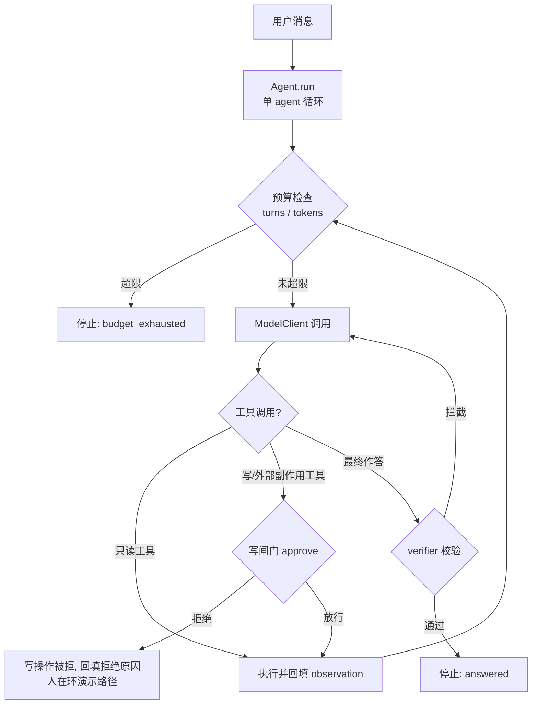

# agent-loop-safety

[English](README_EN.md) | 中文


单 agent 循环 harness 的**安全原语骨架** + 一套**评测对比工具**，提炼自 Anthropic 的
[《Building agents: When to fold subagents into your main agent loop》](https://claude.com/resources/articles/building-agents-when-to-fold-subagents-into-your-main-agent-loop)
与其配套仓库 [single-agent-loop-kit](https://github.com/anthropics/single-agent-loop-kit)。

不是框架，不绑定任何模型 SDK。把你的模型客户端实现 `ModelClient` 协议即可接入；把你的
eval 体系接到 `BaseEvalRunner` 即可获得「改一处、比一处」的回归对比。

> ⚠️ 这是**参考骨架 / 教学实现**，不是生产级 runtime。Anthropic 原仓库也自述
> "Reference implementation. Not maintained." 本仓库同理：安全原语的*形态*可用，
> 但「折叠子智能体能提速/提质」这一主张的实证极薄（原文 1 个客户、工具包 1 个玩具示例、
> 单人单模型两次，且 merge/upkeep 路径从未在真实模型上跑过）。本仓库帮你**严谨地度量你自己的系统**，
> 而不是替你下结论。

## 包含什么

```
agent-loop-safety/
├── agent_loop.py          # 单 agent 循环：预算/写闸门/verifier/渐进披露
├── adapters.py            # 真实客户端示例：AnthropicModelClient / OpenAIModelClient
├── evalkit/
│   ├── runner.py          # BaseEvalRunner：把你自己的 eval 挂进来的接入点
│   ├── compare.py         # 两套 eval 并排比：通过率/延迟/调用/token/成本 + 路由变化
│   ├── chain_coverage.py  # 每条生产链路都要有 eval 任务覆盖（防漏测）
│   ├── coupling_map.py    # 从 trace 看谁扛流量、谁总一起跑（决定能不能合并）
│   └── estimate.py        # 按已测 variant 估算下一次 run 的 token
├── examples/
│   ├── real_model_demo.py          # 接真实模型的端到端示例（Anthropic / OpenAI 二选一）
│   └── agent_redteam_integration.py # 进阶：把 red-team harness 包成受闸门保护的 Tool + evalkit 全流程
├── tests/                 # 离线单测（无需任何 API key）
├── pyproject.toml
├── LICENSE                # Apache-2.0（与原作一致）
└── NOTICE                 # 溯源声明
```

## 安装

```bash
git clone https://github.com/aidless/agent-loop-safety.git
cd agent-loop-safety
python -m venv .venv && source .venv/bin/activate
pip install -e .                      # 零依赖即可跑骨架与 eval 工具
pip install -e ".[anthropic]"         # 若要用 AnthropicModelClient
pip install -e ".[openai]"            # 若要用 OpenAIModelClient
```

## 快速开始（离线自检）

```bash
python agent_loop.py
# stop=answered / turns=4 / tokens=290/69 / final text='已完成。'
```

它用内置 `FakeModelClient` 验证：read 工具跑通 → write 工具被闸门拒绝 → 作答被 verifier
拦一次 → 修正后定稿。说明循环、并行批次、写闸门、verifier 都已生效。

跑全部单测（无 key、无网络）：

```bash
python -m unittest discover -s tests -t .
```

## 循环与安全原语流程图



（闸门/verifier/预算都在 `agent_loop.py` 的 `Agent` 内，任何 `ModelClient` 适配器只做消息翻译，不绕过安全原语。）

## 实测数据 / 评测结果表

以下数字全部来自 2026-11-10 本机实跑（Linux · Python 3.12，零依赖、无 API key），命令与输出可复现：

| 检查 | 命令 | 实测结果 |
|---|---|---|
| 离线循环自检 | `python3 agent_loop.py` | `stop=answered / turns=4 / tokens=290/69 / final text='已完成。'`（read 工具跑通 → write 被闸门拒绝 → verifier 拦一次 → 修正定稿） |
| 离线单测 | `python3 -m unittest discover -s tests -t .` | `Ran 6 tests in 0.007s`，**OK**（0 失败） |
| evalkit 对比（Mock 后端） | `python3 examples/agent_redteam_integration.py --flow-dir <dir>` | baseline vs locked：pass_rate **1.0000 → 0.0000**（3 任务全部翻转 t01/t02/t03）；latency 0.533→0.333 ms；model_calls 9→9；tokens 690/171 不变 |
| chain_coverage | 同上 | `OK (3 prod chains, 1 eval chains)` |
| 真实模型端到端 | `python3 examples/real_model_demo.py` | 无 key 时打印接入说明、退出码 2（诚实降级，见 Limits） |

> 评测数字的语义：`agent_redteam_integration.py` 是 Mock harness 演示——
> 它证明的是「**闸门开关确实改变评测结果、evalkit 能把变化归因到具体任务**」
> 这条度量链路可用，**不是**任何安全或性能结论。

## What this doesn't claim / Limits

- **参考骨架 / 教学实现，不是生产级 runtime**（Anthropic 原仓库亦自述 "Reference implementation. Not maintained."）。
- 「折叠子智能体能提速/提质」这一主张**实证极薄**：原文 1 个客户、工具包 1 个玩具示例、单人单模型两次，merge/upkeep 路径从未在真实模型上跑过。本仓库帮你度量你自己的系统，不替你下结论。
- 本 README 的全部评测数字来自 Mock/Fake 后端，不含任何真实模型调用；真实模型路径需要 key 且未在本机验证。
- 写闸门的 `approve` 由调用方注入；骨架不提供身份认证、审计持久化或并发安全。


### 接真实模型（端到端示例）

`examples/real_model_demo.py` 已把骨架接到真实后端，按环境变量选 Anthropic / OpenAI：

```bash
export ANTHROPIC_API_KEY=sk-...        # 用 Anthropic 后端
# 或 export OPENAI_API_KEY=sk-...      # 用 OpenAI 后端
pip install -e ".[anthropic]"          # 或 ".[openai]"
export ALLOW_WRITES=1                  # 可选：放行写工具（否则默认拒绝，演示"人在环"）
python examples/real_model_demo.py
```

无 key 时脚本会打印接入说明并以退出码 2 结束（不会报错）。写闸门 / 预算 / verifier 仍由 `Agent` 掌控，适配器只做消息格式翻译。

### 进阶示例：接 red-team harness 并跑评测纪律

`examples/agent_redteam_integration.py` 演示如何把外部 red-team 平台（真实 `agent_redteam` 包若已安装则自动 lazy-import 作后端；否则用内置 Mock）的攻击能力包成 Tool——其中 `run_attack` 是写/外部副作用工具，**必须过写闸门**；并用 `evalkit` 跑 baseline（放行攻击）vs locked（拦截攻击）两个 variant，直接看到闸门如何改变评测结果：

```bash
python examples/agent_redteam_integration.py --flow-dir flow_redteam
```

完全离线可跑（FakeModelClient + Mock harness），输出 `compare` 的 flips / `chain_coverage` 结论，结果落盘到 `flow_redteam/`，可直接二次 `compare`。

## 接入你自己的模型客户端

实现 `ModelClient.create(...)`，返回 `ModelResponse`（内容块用带
`.type/.text/.id/.name/.input` 属性的对象，与 Anthropic SDK 块对齐）。

```python
from agent_loop import Agent, Tool
from adapters import AnthropicModelClient

tools = [
    Tool("lookup", "Read-only lookup.", {...}, lookup_fn, writes=False),
    Tool("publish", "Writes externally.", {...}, publish_fn, writes=True),
]

agent = Agent(
    system="你是助手。",
    tools=tools,
    client=AnthropicModelClient(model="claude-opus-4-5"),
    approve=lambda tool, args: human_approves(tool, args),   # 写操作的"人在环"闸门
    verify=lambda text, msgs: None,                          # 可选：最终答复校验
)
result = agent.run("查一下温度并发布。")
```

`adapters.py` 里的 `AnthropicModelClient` / `OpenAIModelClient` 是**完整示例**，含消息格式
双向翻译；按需替换成你自己的后端即可。

## 接入你自己的 eval（「改一处、比一处」）

```python
from evalkit.runner import BaseEvalRunner, EvalResult

class MyRunner(BaseEvalRunner):
    def run_one(self, task) -> EvalResult:
        # 在这里调你的 agent / 系统，返回标准结果
        return EvalResult(
            task_id=task["task_id"], passed=..., route=[...], chain=task["chain"], ...
        )

r = MyRunner("flow/", tasks)
r.run_variant("baseline", reps=2)   # 产出 flow/baseline/results.jsonl
# ... 折叠一个子 agent 后 ...
r.run_variant("v1", reps=2)
r.compare("baseline", "v1")         # 并排对比，返回 holds / flips / routes
r.check_coverage("traces.jsonl", "baseline")   # 生产链路是否都有任务覆盖
```

CLI 直跑：

```bash
python -m evalkit.compare flow baseline v1
python -m evalkit.chain_coverage traces.jsonl flow baseline
python -m evalkit.coupling_map traces.jsonl
python -m evalkit.estimate flow baseline --reps 2 --actual v1
```

标准结果布局 `<flow>/<variant>/results.jsonl`，每行一个任务运行，字段：
`task_id, rep, passed, latency_ms, model_calls, input_tokens, output_tokens, cost,
route, writes, chain`（与 Anthropic kit 的 `/claude/hillclimb/<name>/<variant>/` 对齐）。

## 安全原语一览

| 原语 | 行为 |
|---|---|
| **write gate** | 有写工具却没传 `approve=` → 构造期直接抛错；运行时兜底也拦「无闸门的写」。**缺失闸门绝不默认放行。** |
| **token 预算** | `max_tokens` 累计 input+output，且 `charge()` 让子 agent 把花费计入同一预算 |
| **turn 预算 / 批次上限** | `max_turns`（默认 25）/ `max_batch`（默认 16），超限返回错误结果 |
| **verifier** | 答案被挑刺一次给修正机会，两次仍不过则扣留不返回 |
| **渐进披露** | 系统提示只放 skill 一行描述（`load_skill` 按需加载）；`deferred` 工具走 `tool_search` |

## 重要声明

- 本仓库**独立实现**，与 Anthropic 无隶属或背书关系（见 `NOTICE`）。
- 「单循环优于多子 agent」是**条件性结论**，原文明确保留三类该用子 agent 的场景
  （上下文膨胀致可测性能下降 / 需并行且用完即弃 / 单 agent 选不准工具或提示冲突）。
- 证据强度有限：不要把它当成普遍定律，而要把它当成**你该去度量的假设**。
  `evalkit` 这套工具就是为这个度量而生的。

## 许可证

Apache-2.0。见 [LICENSE](LICENSE)。
